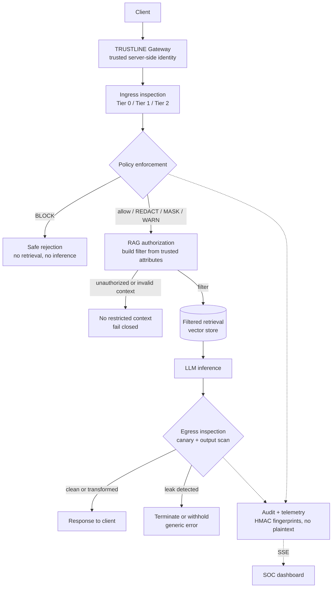

# TRUSTLINE — AI Security Gateway

*A lightweight security gateway that helps prevent sensitive-data leakage through AI applications.*

**CyberCup 6.0 · CC6-AI03: Detection and Prevention of Data Leakage through AI Models**

> [!IMPORTANT]
> **Status (2026-10-15):** design stage. This repository currently contains only this README. It has no application code, dependency manifests, configuration or tests yet. Every component below is **Planned** and describes intended behavior, not verified behavior.

## Overview

AI applications put sensitive data next to a component that follows natural-language instructions and cannot reliably tell instructions from data. Users paste PII and credentials into prompts. Attackers inject instructions to extract protected context. RAG pipelines retrieve restricted documents and then *ask* the model not to reveal them. TRUSTLINE sits between clients and the AI application. It inspects incoming prompts for sensitive data and adversarial instructions, enforces security policy, restricts RAG retrieval to documents the caller is authorized to see, and inspects generated responses before release. The design applies defense in depth: **the gateway and the retrieval layer enforce protection themselves instead of relying on the language model.** A system prompt saying "never reveal confidential data" is an input to a probabilistic model, not an access-control decision.

The gateway provides five controls: inbound DLP, access-controlled RAG, outbound protection, privacy-preserving audit logging and a SOC dashboard.

## Architecture



How a request moves through the gateway:

1. **Identity.** Comes from server-side authentication. Roles the client submits in the request are never trusted.
2. **Ingress.** Tiered detectors inspect the normalized prompt. The policy engine maps each finding to an action. A `BLOCK` ends the request before any retrieval or inference.
3. **Authorization before retrieval.** Permissions are compiled into a metadata filter that runs *inside* the vector query, so restricted documents never become candidates. Missing or ambiguous authorization never widens access.
4. **Egress.** Output is checked for canaries and sensitive data before release.
5. **Telemetry.** Each decision emits one sanitized event to the audit store and the SOC stream.

## Core Security Features

All five capabilities are **Planned**.

| Capability | Approach | Purpose |
|---|---|---|
| **Inbound DLP** | **Tier 0:** regex, checksum validation of identifiers (for example Aadhaar-like numbers and PAN), known secret prefixes and entropy heuristics. **Tier 1:** Microsoft Presidio and spaCy for contextual PII such as names and locations. **Tier 2:** rules, similarity matching and/or a classifier for prompt injection and jailbreaks. Each finding maps to a configurable `BLOCK`, `REDACT`, `MASK` or `WARN` action. | Stop sensitive data and adversarial instructions before they reach the model or its provider. |
| **Access-controlled RAG** | Qdrant or ChromaDB (not yet chosen). The server resolves the caller's roles and clearance, then applies a metadata filter as part of the similarity search. Access is denied by default. | Keep restricted documents out of the context window so the model cannot leak them. Editing role fields in a request has no effect. |
| **Outbound protection** | Output is re-scanned with the ingress detectors. Canary tokens generated at runtime are placed in the system prompt and in restricted documents. A canary match or a serious finding terminates or withholds the response. For streamed output, a sliding-window holdback buffer catches secrets split across chunks. | Catch sensitive data that the model reproduces from retrieved context, training data or earlier turns. |
| **Privacy-preserving audit** | Records hold a keyed HMAC-SHA256 fingerprint (with key version), rule IDs, the decision and per-stage latency. They never hold prompts, PII, secrets, canary values or full outputs. | Allow incidents to be investigated without the logs becoming a second leak path. |
| **SOC dashboard** | Sanitized events stream live over SSE. The dashboard shows incident cards, decision and threat breakdowns, latency, policy status and evaluation results. | Give operators visibility without exposing the content being protected. |

Key design notes:

- **HMAC is not anonymization.** Aadhaar, PAN and phone numbers come from small value spaces, so an unkeyed hash of one can be brute-forced. A secret key prevents that while it stays secret. Identical inputs still produce linkable fingerprints, and a leaked key reopens the brute-force attack. The key must be stored as a secret and rotated.
- **`WARN` is not a block.** Whether a warned request proceeds is a configuration choice. When policy configuration is missing or invalid, the engine fails closed.
- **The demo persona switcher is not authorization.** It selects a test identity that is mapped server-side. Changing it in the UI never grants access.

## Technology Stack and Project Status

| Layer | Intended technology | Status |
|---|---|---|
| Gateway API | Python, FastAPI | Planned |
| Tier 0 detection | Regex, checksums, entropy analysis | Planned |
| Tier 1 detection | Microsoft Presidio, spaCy (`en_core_web_sm`) | Planned |
| Tier 2 detection | Rules / similarity matcher / classifier | Planned (approach undecided) |
| Vector store | Qdrant **or** ChromaDB | Planned (undecided) |
| Inference | Ollama (`llama3.1:8b`) **or** Groq | Planned (undecided) |
| Audit | HMAC-SHA256 fingerprints, metadata store | Planned (store undecided) |
| Frontend | Next.js, React, Tailwind CSS | Planned |
| Charts | Recharts **or** Tremor | Planned (undecided) |
| Telemetry | Server-Sent Events | Planned |
| Testing | pytest, Python evaluation harness | Planned |

Choosing between Ollama and Groq is also a data-flow decision. With hosted inference (Groq), every redacted prompt and every authorized context chunk leaves the team's infrastructure. With local inference (Ollama), data stays on the host, at the cost of hardware and latency.

## Repository Structure

```text
Trustline-ai-security-gateway/
└── README.md        # only file in the repository (commit 9bca967)
```

This tree will grow as code lands.

## Setup and Running Locally

The application cannot be run yet. The only verified step is cloning the repository:

```bash
git clone https://github.com/murali-bitt/Trustline-ai-security-gateway.git
cd Trustline-ai-security-gateway
```

The following are still missing before setup can be documented:

- Python dependency manifest (`requirements.txt` or `pyproject.toml`) and a FastAPI entry point
- Frontend `package.json` and Next.js app
- `.env.example` with placeholder values only, plus a `.gitignore` that excludes `.env`, virtual environments and `node_modules`
- Supporting services, which depend on the decisions above: Docker for Qdrant, Ollama for local inference, or a Groq API key
- Test suite and benchmark runner

Commands, ports and environment variable names will be added here once they exist. None are defined yet.

## API and Integration

No routes exist yet. All endpoints below are **proposed**, and their request and response schemas are **not frozen**.

| Method | Endpoint | Purpose | Status |
|---|---|---|---|
| `POST` | `/api/v1/chat` | Public, authenticated chat request: inspection, policy, authorized RAG, egress | Proposed |
| `POST` | `/internal/rag-infer` | Authorized retrieval and inference, called by the gateway only | Proposed |
| `GET` | `/api/v1/telemetry/stream` | SSE stream of sanitized security events for the SOC dashboard | Proposed |

Integration rules:

- **Derive effective permissions from trusted server-side identity and authorization context.** A client-submitted `user_roles` field, or anything similar, must never change what the caller can retrieve.
- `/internal/rag-infer` must not be publicly reachable. It requires service authentication and accepts authorization context only from the gateway.
- Errors and denials must never echo detected values or reveal whether restricted documents exist.
- The telemetry stream must be authenticated. The native `EventSource` API cannot send an `Authorization` header, so the dashboard needs cookie-based sessions or a `fetch`-based SSE client.

## Testing and Evaluation

Planned benchmark of 35 labeled, fully synthetic prompts:

| Category | Count | Expected outcome |
|---|---|---|
| Benign business prompts | 10 | Accepted without unnecessary redaction or blocking |
| Synthetic sensitive-data prompts | 10 | Handled per the configured policy for each category |
| Adversarial injection prompts | 10 | Detected and handled per policy |
| Unauthorized cross-role RAG queries | 5 | Restricted context never reaches the model |

The harness will report **precision, recall, F1 and false-positive rate** for each category. It will also include a decision confusion matrix, because a correct detection with the wrong action counts as a failure. RAG tests must inspect the **inference input**, not just the final answer, since a model might not repeat content it was given. Restricted test documents therefore carry unique markers. The harness asserts that those markers are absent for unauthorized identities and present for authorized ones.

**Latency target: under 60 ms of gateway inspection overhead** (Tier 0, Tier 1, Tier 2 and the policy decision). Network, retrieval and inference time are measured separately. Results will be reported as p50, p95 and max, with cold start reported separately. This is a **target**. No benchmark results exist yet, and no test command exists yet. pytest is planned.

## Team and Demo

| Team member | Responsibility |
|---|---|
| Person 1 | Gateway, detection, policies, egress inspection, audit logging |
| Person 2 | Authorized RAG, inference, test harness, evaluation |
| Person 3 | Chat frontend, SOC dashboard, telemetry visualization, presentation |

Planned judge scenarios. **None can run yet**, and all data used will be synthetic.

1. **Sensitive data at ingress.** A prompt containing a synthetic PAN and a fake token-shaped credential is redacted or blocked according to policy. Judges see that the model received only placeholders, or that no inference call happened. The audit record holds only a fingerprint.
2. **Unauthorized RAG access.** An Intern persona and an HR Lead persona ask the same question. Only the HR Lead's retrieved document IDs include restricted documents. Editing the client-submitted roles changes nothing.
3. **Egress and canary protection.** A runtime canary is seeded into synthetic restricted context. When the model reproduces it, the response is terminated with a generic error. The SOC dashboard shows the incident without the canary value.

## Security Limitations

TRUSTLINE reduces the risk of AI data leakage. It does not eliminate it. Detectors will miss some novel prompt injections, unknown secret formats, low-entropy passwords and non-English PII. They will also flag some benign input. Prompt filtering alone cannot solve prompt injection, which is why authorization and egress inspection must hold even when Tier 2 misses. Authorization is only as strong as its server-side enforcement: if roles are trusted from the client or filtering happens after retrieval, the core control fails. Canary checks are a tripwire. A match proves exposure, but paraphrased, translated or encoded leaks will not match. Detection quality and the 60 ms overhead target remain unproven until the benchmark produces measured results. None of this is production-ready.
